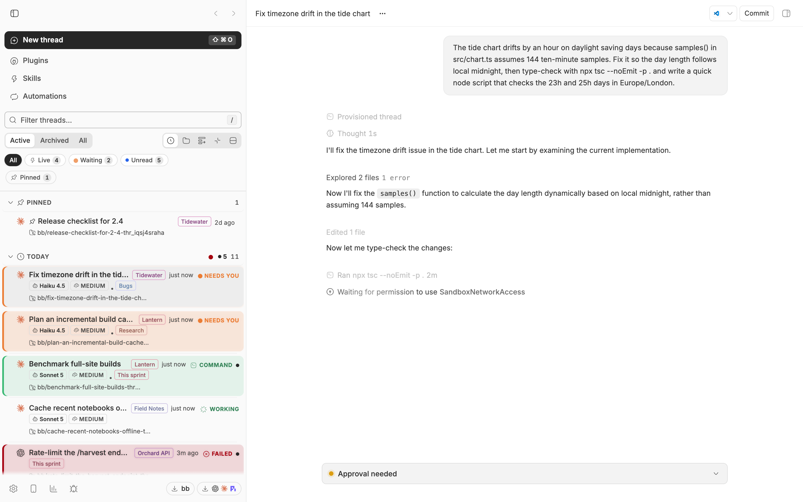
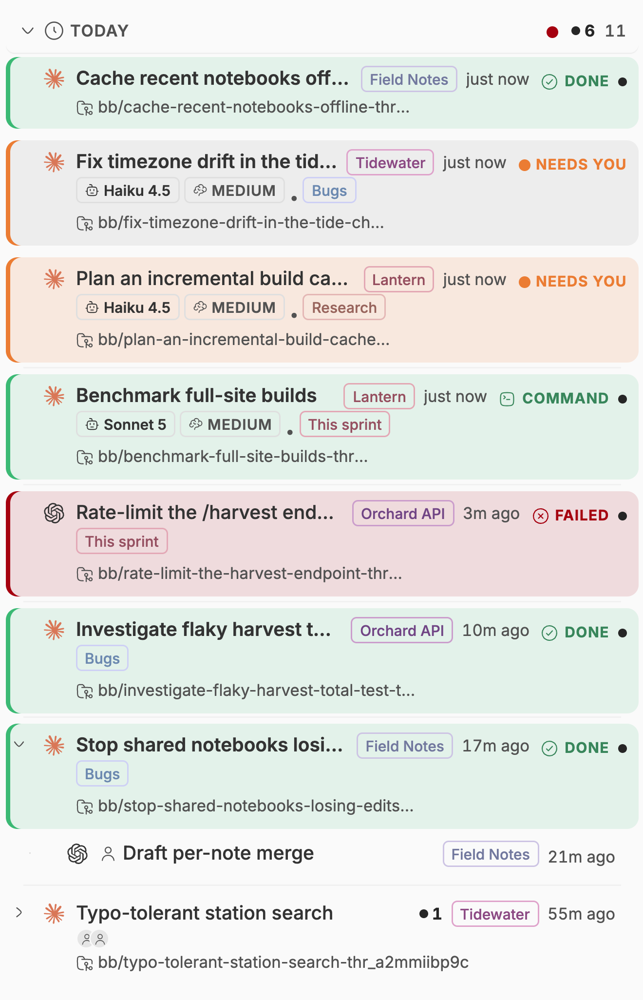
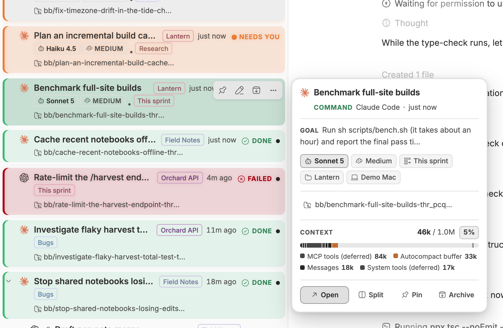
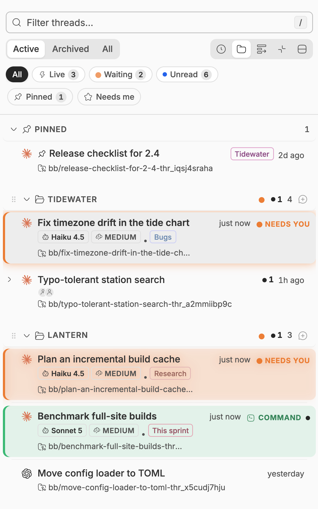
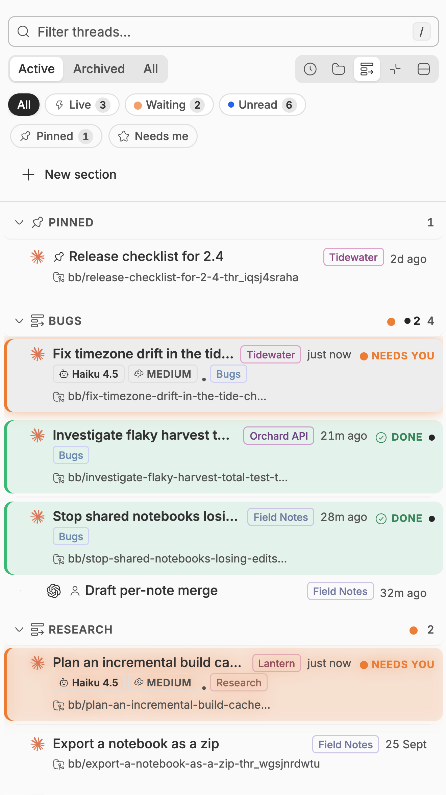
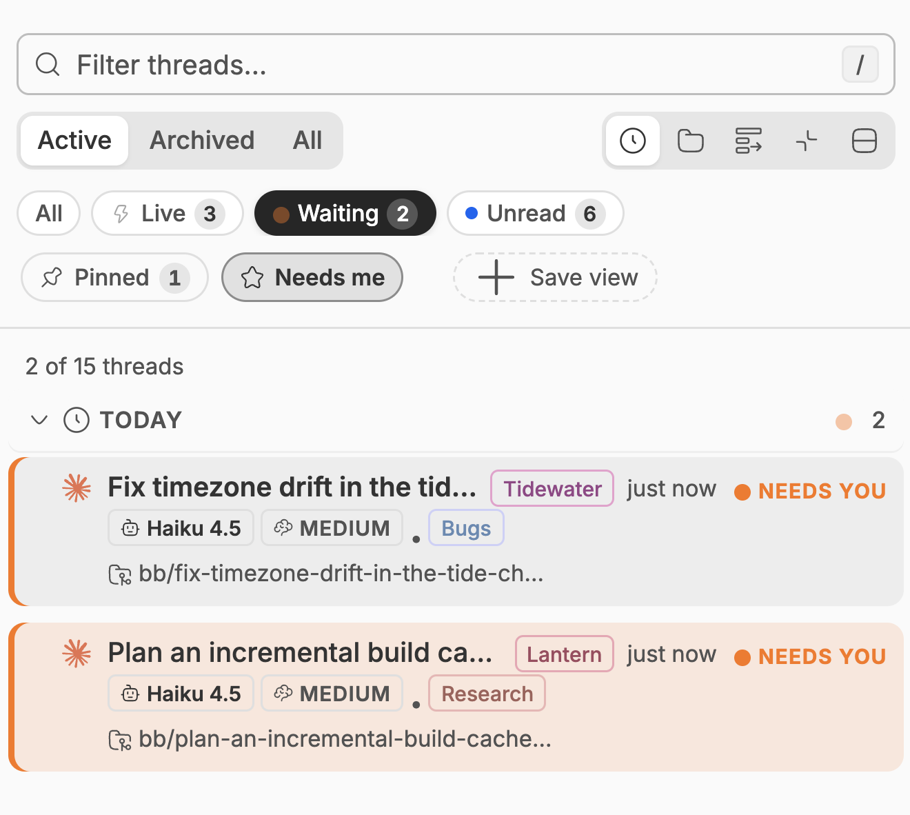
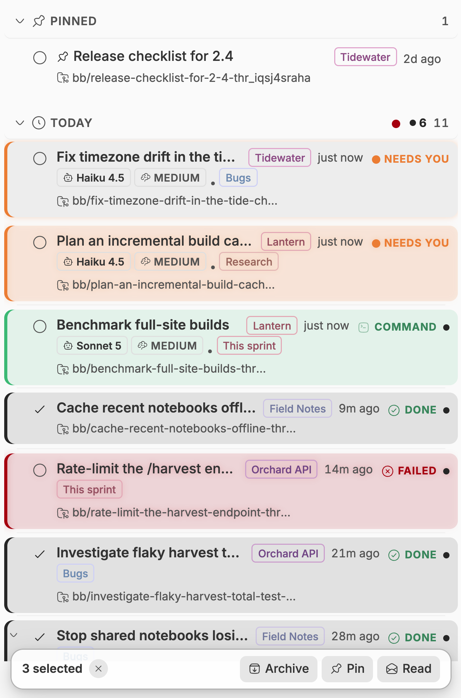
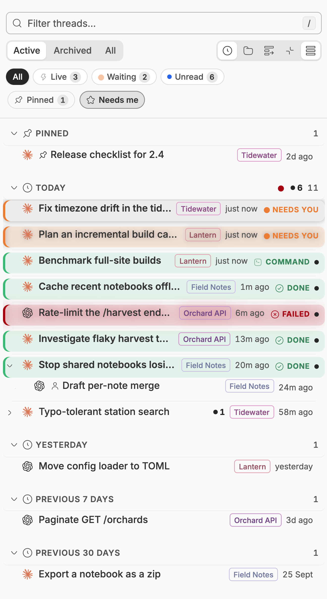
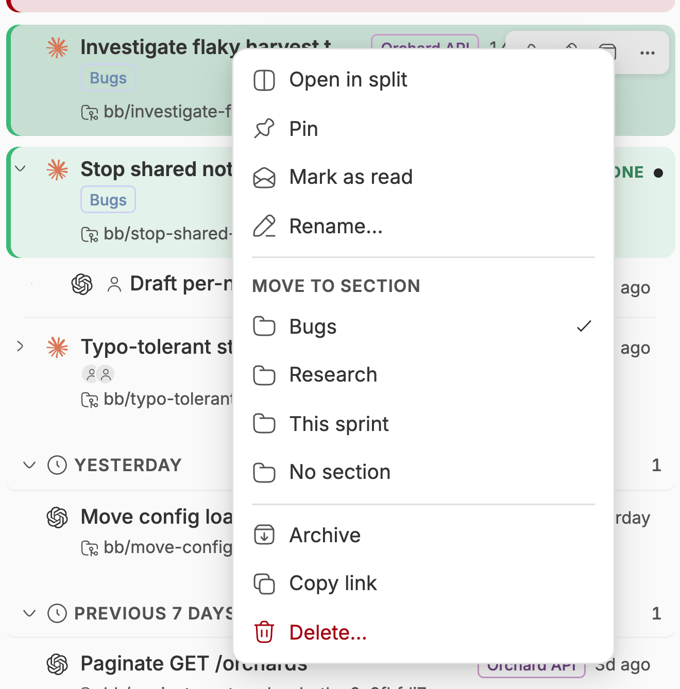
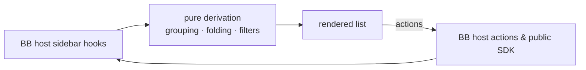

<div align="center">


# Spools

### See which of your threads needs you, at a glance.

Spools replaces BB's sidebar thread list with a layout built for people
juggling dozens of agent threads at once.<br>
Grouping, folding and attention states do the sorting for you, so nothing that
needs a decision hides at the bottom of the list.

> Forked from [MacHatter1/bb-plugin-radar-sidebar](https://github.com/MacHatter1/bb-plugin-radar-sidebar)
> (MIT). The original radar sidebar is this plugin's foundation; Thread Spools
> and the renames are layered on top of it.


[Features](#features) · [Install](#install) · [How it works](#how-it-works) · [Settings](#settings) · [Development](#development)

<br>



</div>

<br>

> [!NOTE]
> The screenshots are real BB captures populated with fictional demo data.

## The problem

You have forty agent threads open across six projects. Two are waiting for a
decision, one failed twenty minutes ago, and three finished while you were
somewhere else. BB's sidebar sorts them all the same way, so finding the ones
that need you is a manual sweep — and the moment you click a thread to look, it
jumps to the top of "Today" and you lose track of what was actually moving.

Spooler is opinionated about the difference between *recent* and *important*.
Activity decides where a thread sits, not when you last opened it. Threads that
need something from you are impossible to miss, and threads that are simply
quiet get out of the way.

|  | Without Spooler | With Spooler |
| --- | :---: | :---: |
| Tell working from finished without reading | ❌ | ✅ distinct icon, word and colour per state |
| Opening a thread changes its group | ❌ it jumps to Today | ✅ grouping keys off real activity |
| See what a collapsed family is hiding | ❌ | ✅ count, unread rollup and loudest state |
| Spot a thread waiting for your input | ❌ | ✅ amber chip whose dot breathes |
| Tell which provider and model a thread runs | ❌ | ✅ icon, model and thinking on the row |

## Features

<table>
<tr>
<td width="50%" valign="top">

### 🛰️ Activity grouping

Threads group by Today, Yesterday, Previous 7 days, Previous 30 days or Older,
keyed off last *activity* — not last read. A thread you merely opened stays
where it belongs, and anything running or waiting surfaces to Today. Group by
project or section instead with one toggle. In section view, choose **New
section**, enter a name, then **Create section**. File threads with **Move to section** in a thread's
⋯ / right-click menu (or press-and-hold on touch); drag handles are
retired — relocation is menu-only. Sections carry a
chosen icon in the header — identity is icon-only; the sidebar stays bb-app's
plain flat rows, and status colour lives in the lead glyph, pills and words,
never washes.

Restore the section list to one glance: an optional **Active deck** pins a
caption **with its cards** above it — the whole overlay stays on top while you
scroll, and each card shows its status glyph, title and home (spool, section
or Inbox) while the originals never leave their sections. The caption folds
like any other group, remembered with the other group-collapse choices, and
the View menu's Expand-All / Collapse-All reach it. The filter header itself
folds to one line: a chevron at the search bar's right edge (pointing right
when collapsed, down when expanded) hides the status chips row and every
control but the Grouping widget — grouped left, chevron right — and
<kbd>/</kbd> from the collapsed state re-opens it focused.

</td>
<td width="50%" valign="top">

### 🔴 Loud attention states

Working, needs-you, failed and finished-unread each get their own lead glyph,
word or pill. The 16px lead carries the shape; the meta line carries the word
("Working · Command") or the pill ("Needs you", "Failed", "Queued"), so
status is never colour-only. Finished-but-unseen threads keep an ink unread
dot and a bolded title. Motion is reserved for things that need action — the
needs-you dot pulses and the working spinner spins — so movement always means
something.

</td>
</tr>
<tr>
<td valign="top">

### 🪢 Nested families

Child threads sit under their parent with indent guides, and the family sorts by
its freshest activity, so a running child floats its parent. Fold a family and
the summary tells you how many are hidden, how many are unseen, and the loudest
state inside.

</td>
<td valign="top">

### 🔎 Details on demand

Every thread box reads as its own details header: provider icon · lead
status glyph · title on the main line, and a sub-head of status word ·
provider name · time on the left with the pull-request chip and the
project RIGHT-justified on the right. The chevron at the box's upper-right
appends the details flush beneath that header — a hairline separator, then
the goal (three small-type lines), model · effort, branch, pull request,
replies and a context-window meter that is never an empty bar. No
duplicate header inside the panel, no Status row: the row IS the header.
Selecting a thread only paints the selected wash on the header tube; the
details never open on their own (several boxes can be open side by side).
There is no on-hover peek card: hover paints nothing but the tube.

</td>
</tr>
<tr>
<td valign="top" colspan="2">

### ⌨️ Keyboard and bulk control

Arrow keys walk the list, <kbd>Enter</kbd> opens, <kbd>Space</kbd> folds,
<kbd>E</kbd> archives, <kbd>P</kbd> pins and <kbd>X</kbd> selects. The row's
permanent <kbd>⋯</kbd> and the details <kbd>⌄</kbd> join the tab order while
the row holds focus — fixed at the main line's right edge, so they can never
wrap into a margin; spool cards carry their ⋯ left of "Spool (N)". Shortcuts
stay out of text fields, open dialogs and menus, and buttons or links outside the
list, so they never steal keys from the rest of BB. <kbd>⌘</kbd>-click or <kbd>⇧</kbd>-click also selects several,
to act on them together from a floating dock. Save a query plus filters as a
named smart view. Swipe a row, by touch or with two fingers on a trackpad,
to mark it read or archive it; each direction's action is a setting.

</td>
</tr>
</table>

<div align="center">
<table>
<tr>
<td align="center"><br><sub><b>Attention states and nested families</b></sub></td>
<td align="center"><br><sub><b>Details, always open for the selected thread (mockup: docs/details-revamp-mockup.html)</b></sub></td>
</tr>
<tr>
<td align="center"><br><sub><b>Grouped by project</b></sub></td>
<td align="center"><br><sub><b>Grouped by section</b></sub></td>
</tr>
<tr>
<td align="center"><br><sub><b>Status chips and the View menu</b></sub></td>
<td align="center"><br><sub><b>Multi-select and bulk actions</b></sub></td>
</tr>
<tr>
<td align="center"><br><sub><b>Compact density</b></sub></td>
<td align="center"><br><sub><b>Right-click menu</b></sub></td>
</tr>
</table>
</div>

## Install

```sh
bb plugin install 'git:https://github.com/olsonjeffery/olsonjeffery-bb-plugins.git@main' --yes
```

The Git semver range tracks compatible `v0.5.x` releases. If you installed
an earlier minor series, rerun this command to move to the new range.

Then pick it in **Settings → Appearance**: choose **Spools** for the sidebar.
Navigation stays on BB's own rail: BB 0.46 retired the navigation slot that
Spools' navigation and rail were built on, so 0.5.3 removes them. On BB 0.44
or 0.45, keep an earlier release, which still has them.

<details>
<summary><b>Install from a local clone</b></summary>

```sh
git clone https://github.com/olsonjeffery/olsonjeffery-bb-plugins
cd olsonjeffery-bb-plugins/bb-plugin-spools
npm install && bb plugin build
bb plugin install path:$PWD --yes
```

</details>

**Requirements**

- bb **0.46+** (Plugin SDK 0.6.37+)

## Where to find it

| Where | What |
| --- | --- |
| **Sidebar thread list** | Grouped, folded threads with a filter; status chips (All · Needs you · Failed · Working · Unread, with counts) wrap onto a second row on narrow lists instead of hiding labels. |
| **Rows and the ⋯ menu** | Every row keeps a stock ⋯ next to the details chevron at the main line's right edge (fixed, never wrapped); spool cards carry theirs left of "Spool (N)". ⋯, right-click and touch press-and-hold all open one context menu: Open in split, Pin, read, Rename…, Archive, Delete… (top block), Spools filing, Move to section, then Copy link. The menu clamps into the viewport — it shifts upward first, and scrolls only when the whole menu still cannot fit. |
| **View menu (⋯ in the header)** | Smart views, density, expand/collapse all folders, and the spool jump. |
| **Settings → Appearance** | Choose Spools for the sidebar. |

## Compatibility notes

Spools replaces only the thread list. BB 0.46 retired the sidebar navigation
slot that Spools' navigation and rail were built on, so navigation is BB's
own rail and Spools styles none of BB's elements. Nothing here touches BB's
data: thread operations go through BB's own actions and the public SDK, and
client state lives under `spools:*` localStorage keys.

## How it works



- **Reads BB's live state, owns none of it.** Threads, projects and sections
  come from the host's sidebar hooks; pins, reads, renames and archives route
  through BB's own actions, so optimistic updates, confirmations and toasts
  behave exactly as they do in the stock list.
- **Derivation stays out of the components.** Grouping, tree building and
  filter matching live in one hook, `useThreadGroups`, and time bucketing is
  a plain function with no React, so the rows only render.
- **Model info is fetched, then cached per session.** The options endpoint
  resolves *defaults*, so model and effort are shown for any thread — the
  selected row only, so idle lists never storm the model catalog.
  Remounts within the same session reuse cached values; new activity, a
  restart or window focus triggers a refresh.
- **It will not move a thread between projects.** BB's thread API exposes no
  `projectId` on update, so project grouping is view-only; menu filing
  (**Move to section**) files threads into sections, which BB does allow.

## Privacy

- 🛰️ **Nothing leaves the machine.** Spooler makes no network requests of its own;
  every read and write goes to your BB server through the plugin SDK.
- 🧾 **No storage of its own.** No database, no files. Preferences live in
  browser `localStorage`.
- 🔒 **No secrets.** The plugin defines no secret settings and reads none.

## Settings

`bb plugin config spools`, or **Settings → Installed plugins → Spools**.

<details>
<summary><b>All settings</b></summary>

| Setting | Default | |
| --- | --- | --- |
| `celebrate` | `true` | Pop the lead's check glyph once when a thread finishes. |
| `motion` | `true` | Pulse the needs-you dot and spin the working glyph. Also respects `prefers-reduced-motion`. |
| `loudUnread` | `true` | Bold title on finished-but-unseen threads. Off means no bold title, and the ink unread dot still shows. |
| `adaptiveCollapse` | `true` | Fold quiet read-idle rows down to title, project and time — no status word, no pull request on the meta line. |
| `defaultDensity` | `"comfortable"` | `comfortable` or `compact`. Applies until you pick a density in the View menu, which is remembered per client. Compact keeps the meta line with tighter rows and single-line truncation. |
| `twoLineTitles` | `false` | Enable **Two-line titles** to wrap long titles, including mentions, before truncating. Short titles keep their time beside them when they fit; otherwise the title wraps and the meta line stays beneath. Applies in both densities. |
| `swipeActions` | `true` | Swipe a row left or right to act on it: one finger on a touch screen, two fingers on a trackpad. A trackpad swipe stopped short rests open with its action as a button. A mouse's clicks, drags and Shift+wheel are unaffected. |
| `swipeRight` | `"Mark read / unread"` | Action for a rightward swipe: `Mark read / unread`, `Pin / unpin`, `Archive / unarchive`, `Open in split`, `Rename`, `More actions`, `Delete…` (BB confirms) or `Nothing`. |
| `swipeLeft` | `"Archive / unarchive"` | Action for a leftward swipe, from the same list. |
| `activeDeck` | `true` | Show the **Active deck** above the section list in Group By Section: every running thread kept visible while you scroll, one card per thread with its status glyph, title and home. Each card is a duplicate — the thread stays in its section or spool too. The header's chevron collapse (`Hide filter controls`) is remembered per client in `spooler-sidebar:filters-collapsed:v1`. |

The list never waits on settings: until they load it uses the defaults above,
except that `defaultDensity` and `twoLineTitles` use the value this client last
saw, so rows paint at their final height. The provider icon, ⋯ and chevron
share the header without ever changing the row's layout; two-line titles
retired for thread rows (spool card titles keep theirs).

</details>

<details>
<summary><b>Turning it off</b></summary>

```sh
bb plugin disable spools
bb plugin enable spools
```

`bb plugin remove spools` removes the plugin and its settings. Disabling
it returns the sidebar to BB's own list immediately.

</details>

## Development

```sh
npm install
npm test
npm run typecheck
bb plugin build
bb plugin install path:$PWD --yes
bb plugin dev                      # rebuild and reload on every save
```

```
server.ts               the settings the frontend reads; no storage, no CLI
app.tsx                 registers the thread-list slot
app.css                 styles on BB theme tokens, behind the spooler- prefix
components/spooler/       the list, rows, menus, details panel and smart views
components/spooler/*.ts   grouping hook, time bucketing, model cache
lib/swipe.ts            swipe actions and gesture math, shared with server.ts
components/storage.ts   one-time migration of codex-sidebar: preferences
components/ui/          vendored BB UI primitives
skills/                 the bundled agent skill
assets/icon.svg         the plugin icon BB shows (bb.branding.icon)
docs/                   logo and screenshots
```

**Tests** cover time bucketing as plain functions, the
rendered list through BB's plugin test harness (`renderSlot` with seeded
sidebar threads), saved-view validation, preference migration, execution-cache
refreshes, completion timers, and render counts, so a sidebar update re-renders
only the rows that changed. Static guards over `app.css` cover cascade
mistakes jsdom cannot reproduce.
The test setup uses jsdom's `localStorage` explicitly, including on Node 26,
whose native storage global otherwise shadows it without a backing file.

`PLUGIN_OVERVIEW.md` is the store listing. Keep it in step with
`bb.description` in `package.json`.

## Licence

[MIT](LICENSE)
